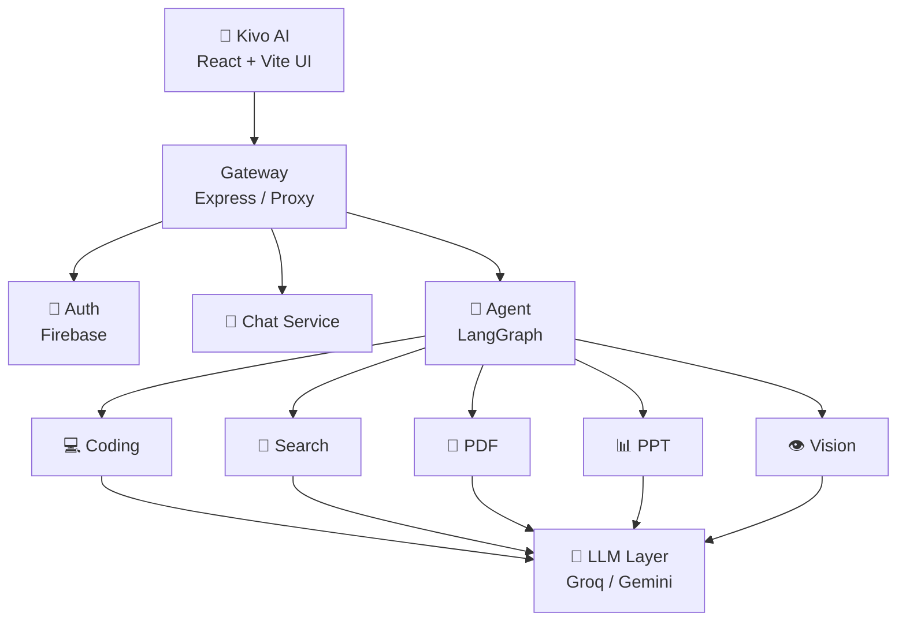

<div align="center">

# 👋 Hey, I'm Anirban Choudhury

### 🤖 AI/ML Engineer • Full-Stack Developer • GenAI Enthusiast

 

<br/>


<br/>

<a href="https://github.com/rickchoudhary115">

</a>
&nbsp;
<a href="https://www.linkedin.com/in/anirban-choudhury-147121325/">

</a>
&nbsp;


</div>

---

## 🧑‍💻 About Me

I'm an **AI/ML student and developer** who loves turning ideas into practical, production-minded AI products. I work at the intersection of **AI agents, LLM apps, and full-stack engineering**, and my goal is to grow into a **production-focused AI Engineer** by shipping real systems.

<table>
<tr>
<td width="55%" valign="top">

### 🔭 Right now

- 🚀 Building **Kivo AI**, a multi-agent AI platform
- 🧠 Going deeper into **Generative AI, RAG and AI agents**
- ⚙️ Learning **MLOps** and production deployment
- 🧩 Practicing **DSA** on LeetCode

### 💬 Ask me about

`AI Agents` · `LangGraph` · `RAG` · `React` · `Node.js` · `Machine Learning`

</td>
<td width="45%" valign="top">

```text
AI / ML
├── Machine Learning
├── Deep Learning
├── NLP
├── Generative AI
├── LLMs
└── AI Agents

Development
├── Python · C++ · JavaScript
└── React · Node.js · Express
```

</td>
</tr>
</table>

---

## 🚀 What I'm Building

<h1 align="center">
  
  Kivo AI
</h1>

<div align="center">

### A Full-Stack Multi-Agent AI Platform

[](https://github.com/rickchoudhary115/MULTIAGENT_AI_SYSTEM)

</div>

<table align="center">
<tr>
<td align="center">💬<br><b>AI Chat</b></td>
<td align="center">🔎<br><b>Web Search</b></td>
<td align="center">💻<br><b>Coding Agent</b></td>
<td align="center">📄<br><b>PDF Agent</b></td>
<td align="center">📊<br><b>PPT Agent</b></td>
</tr>
<tr>
<td align="center">👁️<br><b>Vision</b></td>
<td align="center">🧠<br><b>RAG</b></td>
<td align="center">🔗<br><b>Multi-Agent</b></td>
<td align="center">📦<br><b>Artifacts</b></td>
<td align="center">💳<br><b>Billing</b></td>
</tr>
<tr>
<td align="center">🔐<br><b>Auth</b></td>
<td align="center">⚡<br><b>Redis Memory</b></td>
<td align="center">🤖<br><b>LLM Routing</b></td>
<td align="center">☁️<br><b>Cloud Ready</b></td>
<td align="center">🚀<br><b>Production</b></td>
</tr>
</table>

### 🏗️ Kivo Architecture



---

## 🧠 AI / ML Skills

<table>
<tr>

<td width="25%" valign="top">

### 🤖 Machine Learning

- Supervised / Unsupervised
- Regression & Classification
- Ensemble Learning
- Feature Engineering
- Model Evaluation
- Data Preprocessing
- SMOTE / SMOTEENN
- Scikit-learn

</td>

<td width="25%" valign="top">

### 🧠 Deep Learning

- Neural Networks
- CNN
- RNN
- LSTM
- Model Training
- Model Evaluation

</td>

<td width="25%" valign="top">

### 📝 NLP

- Text Processing
- Tokenization
- Embeddings
- Text Classification
- Semantic Search
- Transformers
- LLM Applications

</td>

<td width="25%" valign="top">

### ✨ Generative AI

- LLMs
- Prompt Engineering
- AI Agents
- Multi-Agent Systems
- LangGraph
- RAG
- Tool Calling
- Structured Outputs

</td>

</tr>
</table>

---

## 💻 Tech Stack

<div align="center">

**Languages**<br/>


**Frontend**<br/>


**Backend**<br/>


**Database & Cloud**<br/>


**Tools**<br/>


</div>

---

## 🔥 Featured Projects

<table>
<tr>

<td width="50%" valign="top">

### 🦝 [Kivo AI](https://github.com/rickchoudhary115/MULTIAGENT_AI_SYSTEM)
**Multi-Agent AI Platform**

A full-stack AI assistant with specialized agents for chat, search, coding, PDFs, slides and vision.


💬 Chat · 💻 Coding · 🔎 Search · 📄 PDF · 📊 PPT · 👁️ Vision · 🧠 RAG · 💳 Billing

</td>

<td width="50%" valign="top">

### 🧞 [Genie AI Builder Workspace](https://github.com/rickchoudhary115/Genie_Ai_Builder_Workspace)
**AI Agent Builder**

A workspace for creating, managing and integrating AI agents, with a React 19 UI and an Express 5 + MongoDB backend.


🤖 Agents · 🔌 Integrations · 🔐 Auth · 🧠 Redux

</td>

</tr>
<tr>

<td width="50%" valign="top">

### 🛂 US Visa Prediction
**Machine Learning Application**

An ML system that predicts visa approval outcomes, served through an API.


🧪 Feature Engineering · ⚖️ SMOTEENN · 🔄 ML Pipelines · 🚀 API Deployment

</td>

<td width="50%" valign="top">

### 📚 Library Management
**Full-Stack Management System**

A platform for managing books, members and transactions.


📖 Books · 👤 Members · 🔐 Auth · 📚 Issue/Return · 💰 Fines · 🛡️ Admin

</td>

</tr>
</table>

---

## 🧩 Learning Roadmap

<div align="center">

✨ **Generative AI** → 🧠 **LLMs** → 🔎 **RAG** → 🤖 **AI Agents** → 🔗 **Multi-Agent** → ⚙️ **MLOps** → 🚀 **Production AI**

</div>

---

## 📈 GitHub Stats

<div align="center">


<br/>


</div>

---

## 🎯 2026 Goals

<table>
<tr>

<td width="50%" valign="top">

### ✅ Completed

- [x] Full-stack applications
- [x] Machine learning projects
- [x] Deep learning
- [x] NLP
- [x] AI-powered applications
- [x] Multi-agent AI system
- [x] RAG
- [x] AI agents

</td>

<td width="50%" valign="top">

### 🚀 In Progress

- [ ] Master Generative AI
- [ ] Production AI deployment
- [ ] MLOps
- [ ] Open source contributions
- [ ] 300+ LeetCode problems
- [ ] AI/ML internship
- [ ] Production AI Engineer

</td>

</tr>
</table>

---

## 💡 My Development Philosophy

<div align="center">

> ### "Don't just learn technology. Build with it."

📚 **Learn** → 🔨 **Build** → 💥 **Break** → 🐛 **Debug** → ⚡ **Improve** → 🚀 **Deploy** → 🔁 **Repeat**

</div>

---

## 🤝 Let's Connect

<div align="center">

I'm open to collaborating on:

**🤖 AI / ML** · **🧠 Generative AI** · **🔗 AI Agents** · **🌐 Full-Stack Development** · **🚀 Startup Ideas** · **💻 Open Source**

<br/>

<a href="https://github.com/rickchoudhary115"></a>
<a href="https://www.linkedin.com/in/anirban-choudhury-147121325/"></a>

</div>


<div align="center">


**Created & developed with ❤️ by Anirban Choudhury**

</div>
